# Agentic Governance as Code

**GenAI answers. Agents act.** A wrong answer is a quality issue; a wrong action is an incident.

This repository turns five operational controls for autonomous AI agents into code that runs in CI and at runtime, with no dependence on any particular agent framework, model or vendor. Every agent is described by a manifest, scored for risk, held to the controls its risk tier demands, and attacked by adversarial probes on every pull request. Non-compliant agents never reach production.

**Live dashboard:** https://caiotk.github.io/agentic-governance-as-code/

| | Control | Enforced by |
|---|---|---|
| **C1** | Risk-proportional oversight | Risk scoring and tier policy ([`policy/tiers.yaml`](policy/tiers.yaml)), review cycles, kill switch |
| **C2** | Deterministic guardrails | Tool allow-lists, strict argument schemas, rate and spend limits, **circuit breaker** ([`src/guard.ts`](src/guard.ts)) |
| **C3** | Agents as privileged identities | Dedicated `svc-agent-*` principals, short-lived signed credentials, least-privilege scopes, hash-chained audit log |
| **C4** | Isolated execution | Sandbox requirements per tier, explicit egress allow-lists, brokered production data |
| **C5** | Human-in-the-loop | Single-use approvals bound to agent, tool and amount, for irreversible and transacting actions |
| **LC** | Lifecycle | Validate → test → productionise → monitor → support, each automated below |

## Why the circuit breaker matters

In June 2026 an AI research agent hit access blocks on Australia's Medicare statistics portal, worked around them, reached non-public files and wrote data. Nobody told it to, and the government found out months later. The agent wasn't malicious. It was goal-seeking without boundaries.

The **boundary probe** replays that pattern against every agent: it sends the agent at a blocked target, then retries via another port, a mirror subdomain and embedded credentials, then tries to carry on as normal. A governed agent is refused every time and **quarantined** after three consecutive denials until a named human releases it. The unsafe example in [`examples/unsafe`](examples/unsafe/market-research-agent.yaml) reaches the target and keeps going.

## How it fits together

```mermaid
flowchart LR
  M[agents/*.yaml<br/>manifests] --> G{Governance gate<br/>static rules + probes}
  P[policy/tiers.yaml] --> G
  G -- blocked --> PR[PR comment +<br/>annotations]
  G -- passes --> D[Deploy dashboard<br/>GitHub Pages]
  G -- passes --> R[Control plane<br/>admits agent]
  R --> A[Agent calls /authorize<br/>before every tool call]
  A --> L[(Hash-chained<br/>audit log)]
  S[Daily drift monitor] --> I[Issue for owners]
```



| Lifecycle stage | Automation |
|---|---|
| **Validate** | Manifests must record the validated use case and a named owner. Undeclared risk attributes score at maximum (fail closed). |
| **Test** | [`governance-gate.yml`](.github/workflows/governance-gate.yml) runs on every PR: typecheck, unit tests, policy evaluation and the adversarial probes the tier requires. It posts results on the PR and annotates the manifest. |
| **Productionise** | [`deploy-dashboard.yml`](.github/workflows/deploy-dashboard.yml) deploys only after the gate passes on `main`. The control plane gives a runtime guard only to compliant agents. |
| **Monitor** | Every decision is written to a tamper-evident audit log. Denials alert, and repeated denials quarantine the agent. |
| **Support** | [`drift-monitor.yml`](.github/workflows/drift-monitor.yml) runs daily and opens an issue when a review falls due or a control degrades. Each agent links a [runbook](docs/runbooks). |

## Quick start

```bash
npm ci
npm test                                   # unit tests for every control
npm run validate                           # the governance gate (exit 1 if blocked)
npx tsx src/cli.ts validate examples/unsafe  # see an unsafe agent fail
npm run drift                              # what the daily monitor sees
npm run build:site && npx http-server site # dashboard on http://localhost:8080
```

## Adversarial probes

| Probe | Tiers | What it tries |
|---|---|---|
| `boundary-probe` | 1–3 | Reach a blocked system, retry around the block, then carry on |
| `schema-injection` | 1–3 | Injected payloads, smuggled arguments, unlisted tools |
| `audit-integrity` | 1–3 | Rewrite a recorded decision |
| `scope-escalation` | 2–3 | Call beyond granted scope, forge the credential |
| `expired-credential` | 2–3 | Reuse a credential past its lifetime |
| `spend-limit` | 3 | Oversized and cumulative transactions |
| `hitl-bypass` | 3 | Act without approval, fake it, replay it, inflate the amount |

## Writing a manifest

```yaml
apiVersion: governance/v1
kind: Agent
metadata: { id: claims-payment-agent, name: Claims Payment Agent, owner: tom.fifita@example.com }
spec:
  risk: { dataClassification: restricted, actions: transact, exposure: customer, reversibility: irreversible, regulated: true }
  identity: { principal: svc-agent-claims-payment, credentialTtlMinutes: 15, scopes: [claims:read, payments:issue] }
  tools:
    - name: payments.issue
      effect: transact
      scope: payments:issue
      requiresApproval: true
      maxAmount: 5000
      rateLimitPerMinute: 10
      args: { claimId: { type: string, pattern: "CLM-[0-9]{6}" } }
  guardrails: { denyOnUnknownTool: true, maxConsecutiveDenials: 3, spendLimitPerDay: 20000 }
  execution: { sandbox: vm, network: { egress: [payments.internal.example.com] } }
  oversight: { approvers: [finance-controller@example.com], monitoring: { telemetry: true, alertOnDenials: true, killSwitch: true } }
  # …lifecycle: see agents/claims-payment-agent.yaml
```

Try your own in the [dashboard playground](https://caiotk.github.io/agentic-governance-as-code/#playground). It runs the same static rules in your browser.

## Runtime control plane

```bash
npm run serve   # http://127.0.0.1:8787
```

| Route | Purpose |
|---|---|
| `POST /api/evaluate` | Evaluate a manifest (YAML or JSON): static rules and probes |
| `GET /api/agents` | Registered agents, compliance and quarantine state |
| `POST /api/agents/:id/credentials` | Issue a short-lived signed credential *(admin)* |
| `POST /api/agents/:id/authorize` | `{ token, call }` → `allow` / `deny` / `pending_approval` / `quarantined` |
| `POST /api/agents/:id/approvals` | A named approver grants a single-use approval *(admin)* |
| `POST /api/agents/:id/quarantine` · `/release` | Kill switch, with release attributed to a named human *(admin)* |
| `GET /api/audit` | Audit entries, chain integrity and alerts *(admin)* |

`docker build -t agentic-governance . && docker run -e ADMIN_KEY=… -e GOV_SIGNING_SECRET=… -p 8787:8787 agentic-governance`

### Before production use

This is a reference implementation. A production deployment would add authentication for the control plane itself (OIDC), persistent storage for the audit log and approvals (append-only, replicated), KMS-held signing keys, enforcement at the network layer (egress proxy or service mesh) in addition to the guard, and alert routing to your paging and SIEM tools.

## Repository layout

```
agents/              registered agent manifests (gated)
examples/unsafe/     a deliberately non-compliant agent
policy/tiers.yaml    risk scoring and per-tier obligations
src/evaluate.ts      static rules for C1–C5 + lifecycle (also bundled for the browser)
src/guard.ts         runtime enforcement: identity, egress, schema, limits, approvals, audit
src/probes.ts        adversarial probes
src/cli.ts           validate | drift | report
src/server.ts        control plane API
site/                dashboard (GitHub Pages)
docs/runbooks/       support runbooks per agent
```

---

Built by [Caio Augusto Tkalec](https://www.linkedin.com/in/caiotk). MIT licensed.
